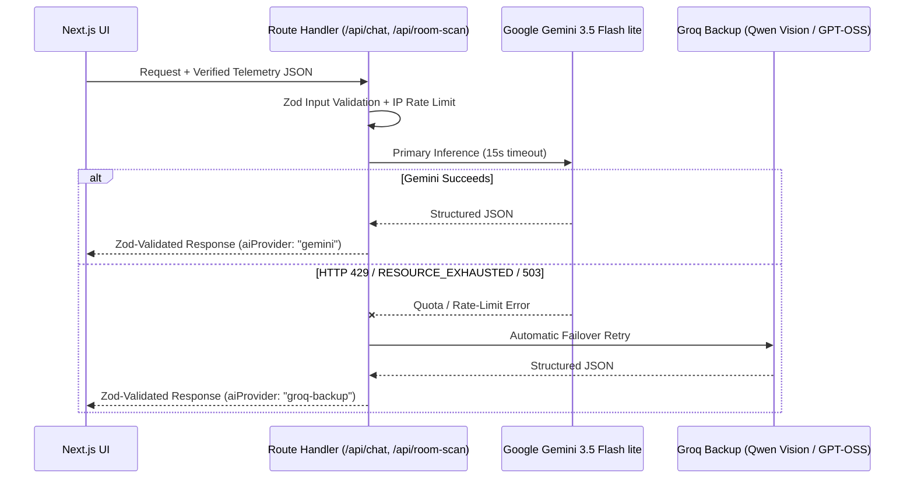

<div align="center">

<br />


<p><strong>Understand the air. Make informed choices. Build cleaner communities.</strong></p>

<p>
  A guest-first, multimodal urban air-quality &amp; sustainable living assistant built for Indian households.<br />
  Powered by <strong>Deterministic Environmental Math</strong>, <strong>Gemini 3.5 Flash lite</strong>, and <strong>Automatic Groq Failover</strong>.
</p>

<br />

<p>
  <a href="https://aq-ai.vercel.app/"></a>
  <a href="#-60-second-evaluator-walkthrough"></a>
  <a href="#-hybrid-system-architecture"></a>
</p>

<p>
  
  
  
  
  
  
</p>

</div>

---

<table align="center" width="100%">
  <tr>
    <td align="center" width="25%">
      <h3><code>0%</code> LLM Math</h3>
      <sub>Pure TypeScript for CPCB/US AQI, 24h windows &amp; CO₂e ranges</sub>
    </td>
    <td align="center" width="25%">
      <h3><code>112/112</code> Tests</h3>
      <sub>0 TypeScript errors · 0 ESLint warnings · 11 test suites</sub>
    </td>
    <td align="center" width="25%">
      <h3><code>100%</code> Guest-First</h3>
      <sub>Zero login wall · Optional Google &amp; Email Firestore sync</sub>
    </td>
    <td align="center" width="25%">
      <h3><code>EN / தமிழ்</code></h3>
      <sub>Grounded bilingual voice consultant with Groq STT/TTS</sub>
    </td>
  </tr>
</table>

---

## ⚡ 60-Second Evaluator Walkthrough

> [!TIP]
> **Zero setup required:** Open [**aq-ai.vercel.app**](https://aq-ai.vercel.app/) directly in Guest Mode. Every feature works immediately without creating an account.

| Step | Route | Action to Test | What to Verify |
| :--- | :--- | :--- | :--- |
| **1. Observe** | `/` | Search **`Mumbai`** or click a city pill → toggle **`IN CPCB` ↔ `US EPA`** → switch Persona to **`Daily Commuter`** | Live Radial AQI Gauge, Weather Wind Dispersion (`Stagnant`/`Dispersing`), Recharts 24h Safe Window chart, and instant Morning/Afternoon/Evening plan adaptation. |
| **2. Scan** | `/room-scan` | Click **`Urban Kitchen Stove`** → Analyze → switch to **`Bedroom Purifier Setup`** → Analyze | Dynamic Gemini 3.5 lite Flash Vision audits with Free/Low-Cost fixes, saveable actions, and permanent **Indoor Sensor Boundary Notice**. |
| **3. Simulate** | `/simulator` | Toggle **`Safe Window Walk`** → then select **`Mid-size Sedan`**, set **`16 km`**, **`Monthly (22d)`**, and expand **`Show Math`** | Strict separation: Exposure updates while CO₂e stays `0.00 kg` for exposure-only swaps; Metro swap shows deterministic WRI India min–max CO₂e range. |
| **4. Act** | `/assistant` | Ask **`Should I jog at 7 AM today?`** → then click **`தமிழில் விளக்குங்கள்`** → click **`Listen`** | Cross-screen context-injected cards (`Direct Answer`, `Why It Matters`, `Provenance Badges`), live Tamil localization, and hands-free Voice STT/TTS. |
| **5. Resilience** | Header | Open **`My Plan`** drawer → then open top-right **`Demo Tools`** → toggle **`Simulate Stale Data`** | Unified cross-screen checklist (`localStorage` or Firestore) and honest amber **`STALE (>60m)`** banner instead of fabricated AQI numbers. |

---

## 🧭 Product Architecture: `OBSERVE → SCAN → SIMULATE → ACT`

<table>
  <tr>
    <td width="50%" valign="top">
      <h3>1. Live Dashboard &amp; 24h Safe Windows (<code>/</code>)</h3>
      <ul>
        <li><strong>Animated Radial AQI Gauge:</strong> Strict Indian CPCB vs. US EPA scale segregation—thresholds are never blended.</li>
        <li><strong>Live Weather &amp; Dispersion:</strong> Parallel Open-Meteo telemetry computing <code>STAGNANT</code> (&lt;6 km/h), <code>MODERATE</code>, or <code>DISPERSING</code> (&gt;15 km/h) smog states.</li>
        <li><strong>24h Safe Window Chart:</strong> Interactive Recharts area chart highlighting Best Ventilation, Best Outdoor, and Peak Smog windows.</li>
        <li><strong>Persona Planner:</strong> Morning, Afternoon &amp; Evening routines tailored to 4 Household Personas + pan-India search &amp; OSM Nominatim GPS reverse geocoding.</li>
      </ul>
    </td>
    <td width="50%" valign="top">
      <h3>2. Multimodal Room &amp; Smog Scan (<code>/room-scan</code>)</h3>
      <ul>
        <li><strong>Vision Audit:</strong> Gemini 3.5 Flash lite (with automatic Groq <code>qwen/qwen3.8-27b</code> failover) audits kitchens, purifiers, windows, and skies.</li>
        <li><strong>Client Compression &amp; Samples:</strong> On-device <code>&lt;canvas&gt;</code> compression (&le;4 MB) + 3 one-click demo photos for instant evaluation.</li>
        <li><strong>Prioritized Fixes:</strong> Zod-validated findings tagged by Risk Level (<code>LOW</code>/<code>MEDIUM</code>/<code>HIGH</code>) and Cost Tier (<code>FREE</code>/<code>LOW_COST</code>/<code>EQUIPMENT</code>).</li>
        <li><strong>Sensor Honesty:</strong> Permanent notice clarifying visual guidance cannot replace a physical indoor air sensor.</li>
      </ul>
    </td>
  </tr>
  <tr>
    <td width="50%" valign="top">
      <h3>3. What-If Impact Simulator (<code>/simulator</code>)</h3>
      <ul>
        <li><strong>India Vehicle Segments:</strong> WRI India / Shakti operational ranges (Hatchback, Sedan, Compact SUV, Two-Wheeler, Metro/Bus).</li>
        <li><strong>Interactive Controls:</strong> Accessible distance/occupancy sliders + <code>Today (1×)</code>, <code>Workweek (5×)</code>, and <code>Monthly (22×)</code> horizons.</li>
        <li><strong>Strict Exposure vs. CO₂e Split:</strong> Separate cards for Personal Exposure Shift and Emissions Impact (Recharts horizontal bar chart).</li>
        <li><strong>Full Transparency:</strong> Expandable <strong>Show Math &amp; Assumptions</strong> drawer + 1-click commit to <code>My Plan</code>.</li>
      </ul>
    </td>
    <td width="50%" valign="top">
      <h3>4. Bilingual &amp; Voice AI Consultant (<code>/assistant</code>)</h3>
      <ul>
        <li><strong>Cross-Screen Memory:</strong> Injects live city AQI, weather dispersion, safe windows, persona, room scan findings, and simulator swaps.</li>
        <li><strong>Structured Cards:</strong> Renders Direct Answer, <em>Why It Matters</em>, Provenance Badges, 1-click Saveable Actions, and Follow-Up Prompts.</li>
        <li><strong>Bilingual Voice (EN / தமிழ்):</strong> Groq <code>whisper-large-v3-turbo</code> STT + <code>orpheus-v1-english</code> TTS with seamless browser Web Speech fallback.</li>
        <li><strong>Cloud Sync:</strong> Optional Google &amp; Email/Password Firebase Auth syncing preferences, plans, and history under <code>users/{uid}</code>.</li>
      </ul>
    </td>
  </tr>
</table>

---

## 🏗️ Hybrid System Architecture

> [!IMPORTANT]
> **Zero-Hallucination Boundary:** LLMs never compute AQI scores, pollutant thresholds, safe windows, or carbon savings. Pure TypeScript engines verify and compute all numbers first, injecting grounded JSON into Gemini/Groq solely for visual analysis, reasoning, and bilingual localization.

```mermaid
flowchart LR
    subgraph EXT["Free Keyless Telemetry"]
        A1[Open-Meteo Air Quality]
        A2[Open-Meteo Weather]
        A3[Geocoding & OSM Nominatim]
    end

    subgraph DET["Deterministic TS Engine (0% LLM)"]
        B1[Indian CPCB & US EPA Math]
        B2[Freshness & Wind Dispersion]
        B3[2h Safe Window & M/A/E Planner]
        B4[WRI India CO2e Range Engine]
    end

    subgraph AI["Multi-Provider AI + Voice"]
        C1[Gemini 3.5 Flash lite - Primary]
        C2[Groq Vision & Chat - 429 Backup]
        C3[Groq Whisper STT & Orpheus TTS]
    end

    subgraph APP["4-Screen WCAG AA App"]
        D1[Dashboard & Radial Gauge]
        D2[Room & Smog Scan]
        D3[What-If Simulator]
        D4[EN / Tamil Voice Consultant]
    end

    EXT --> DET
    DET -->|Verified JSON Context| AI
    DET --> APP
    AI -->|Zod-Validated JSON| APP
```



### Automatic Multi-Provider Failover Flow



---

## 🔬 Scientific Guardrails & Technical Reference

<details>
<summary><strong>📊 Strict AQI Scale Separation (Indian CPCB vs. US EPA)</strong></summary>

<br />

AIRQUA AI computes Indian CPCB sub-indices via linear interpolation:
`I_p = ((I_Hi - I_Lo) / (BP_Hi - BP_Lo)) * (C_p - BP_Lo) + I_Lo` and takes `max(I_p)` across available pollutants—never relabeling US EPA scores with Indian category names.

| Indian CPCB Range | CPCB Category | PM₂.₅ (µg/m³) | US EPA Range | US EPA Category |
| :--- | :--- | :---: | :--- | :--- |
| `0 – 50` | Good | `0 – 30` | `0 – 50` | Good |
| `51 – 100` | Satisfactory | `31 – 60` | `51 – 100` | Moderate |
| `101 – 200` | Moderate | `61 – 90` | `101 – 150` | Unhealthy for Sensitive Groups |
| `201 – 300` | Poor | `91 – 120` | `151 – 200` | Unhealthy |
| `301 – 400` | Very Poor | `121 – 250` | `201 – 300` | Very Unhealthy |
| `401 – 500` | Severe | `250+` | `301 – 500` | Hazardous |

* **Freshness Thresholds:** `< 60m` = `FRESH` · `60–180m` = `STALE` · `> 180m` or upstream error = `UNAVAILABLE`.

</details>

<details>
<summary><strong>🔌 Server API Route Catalogue (9 Hardened Endpoints)</strong></summary>

<br />

| Endpoint | Method | Guardrails, Caching & Engine |
| :--- | :---: | :--- |
| `/api/air-quality` | `GET` | Parallel Open-Meteo AQ + Weather; CPCB/US math, 24h Safe Windows & M/A/E planner; `15m` cache; `simulateStale=true`. |
| `/api/geocode` | `GET` | Pan-India city search via Open-Meteo Geocoding; Zod `2–60` chars; `24h` cache. |
| `/api/reverse-geocode` | `GET` | Server-side OSM Nominatim GPS neighborhood lookup; `8s` timeout; `24h` cache. |
| `/api/room-scan` | `POST` | MIME (`jpeg/png/webp`), `&le; 4 MB`, rate-limited; Gemini 3.5 lite Flash → Groq Vision failover; Zod JSON. |
| `/api/simulate` | `POST` | Pure deterministic Exposure vs. WRI India CO₂e range engine (`1×` / `5×` / `22×` horizons). |
| `/api/chat` | `POST` | Cross-screen context-injected EN/TA consultant (`&le; 800` chars, 6 turns); Gemini → Groq failover. |
| `/api/voice/transcribe` | `POST` | Multipart audio (`&le; 10 MB`) → Groq `whisper-large-v3-turbo` (EN & TA). |
| `/api/voice/speak` | `POST` | Markdown-stripped text (`&le; 1000` chars) → Groq Orpheus WAV (EN) or browser TTS fallback (TA). |
| `/api/actions` | `GET/POST/PATCH` | Firebase Admin ID-token verified CRUD strictly isolated under `users/{uid}/actions/{id}`. |

</details>

<details>
<summary><strong>🔒 Security, Privacy & WCAG AA Accessibility Standards</strong></summary>

<br />

* **Server-Only Secret Isolation:** `GEMINI_API_KEY` and `GROQ_API_KEY` are strictly server-only with runtime guards throwing fatal errors if imported in client bundles.
* **Firestore Security Rules:** Strict per-user isolation (`request.auth != null && request.auth.uid == userId`) for preferences, saved actions, history, and conversations.
* **Medical & Sensor Boundaries:** Never diagnoses medical conditions or guarantees outdoor safety; always discloses that outdoor AQI and photos are not physical indoor air measurements.
* **WCAG AA Accessibility:** Semantic landmarks (`<header>`, `<nav>`, `<main>`, `<section>`, `<footer>`, `role="log"`), `aria-live="polite"`, `aria-pressed` / `aria-expanded`, keyboard focus rings, and &ge; 4.5:1 contrast.

</details>

---

## 🚀 Local Setup & Deployment

```bash
# 1. Clone & install
git clone [https://github.com/singinghearthari/AirQua-AI.git](https://github.com/singinghearthari/AirQua-AI.git)
cd AirQua-AI
npm install

# 2. Configure environment variables
cp .env.local.example .env.local
```

<details>
<summary><strong>⚙️ Environment Variables (<code>.env.local</code>)</strong></summary>

```env
# Required (Server-Only)
GEMINI_API_KEY=your_google_ai_studio_key

# Recommended Backup & Voice Engine (Server-Only)
GROQ_API_KEY=your_groq_api_key

# Optional Cloud Sync (Client-Safe Firebase Config)
NEXT_PUBLIC_FIREBASE_API_KEY=
NEXT_PUBLIC_FIREBASE_AUTH_DOMAIN=
NEXT_PUBLIC_FIREBASE_PROJECT_ID=
NEXT_PUBLIC_FIREBASE_STORAGE_BUCKET=
NEXT_PUBLIC_FIREBASE_MESSAGING_SENDER_ID=
NEXT_PUBLIC_FIREBASE_APP_ID=
```

</details>

```bash
# 3. Verify all 4 engineering quality gates
npx tsc --noEmit   # 0 errors
npm run lint       # 0 errors, 0 warnings
npm test           # 112/112 Vitest tests passing
npm run build      # Production build verification

# 4. Run locally
npm run dev        # http://localhost:3000
```

---

<div align="center">
  
  <br /><br />
  <strong>AIRQUA AI</strong> · Built for <strong>PromptWars Challenge 6</strong> by <a href="https://github.com/singinghearthari">Hariharan J</a>
  <br />
  <sub><a href="https://aq-ai.vercel.app/">Live Deployment</a> · <a href="https://github.com/singinghearthari/AirQua-AI">Repository</a></sub>
</div>
