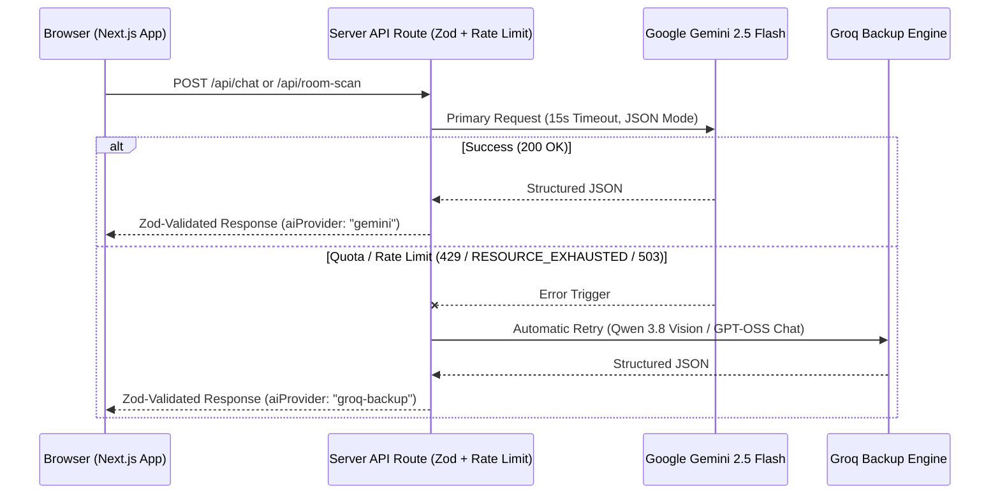

<div align="center">

<!-- HERO BANNER -->


<br />

<p align="center">
  <strong>Understand the air. Make informed choices. Build cleaner communities.</strong>
</p>

<!-- PRIMARY CTA BUTTONS -->
<p align="center">
  <a href="https://aq-ai.vercel.app/">
    
  </a>
  <a href="#-60-second-evaluator-quick-test">
    
  </a>
  <a href="#-hybrid-system-architecture">
    
  </a>
</p>

<!-- TECH & VERIFICATION BADGES -->
<p align="center">
  
  
  
  
  
  
  
</p>

</div>

---

<!-- EXECUTIVE TELEMETRY STRIP -->
<div align="center">

| ⚡ Zero Login Wall | 🔬 0% Hallucinated Math | 🔄 Dual-Engine Resilience | 🎙️ Bilingual EN / தமிழ் |
| :---: | :---: | :---: | :---: |
| **Guest-First UX** + Optional Firebase Google/Email Sync | **Pure TypeScript** CPCB/US AQI, Safe Windows & CO₂e Math | **Gemini 2.5 Flash** with Auto-Failover to **Groq Vision & Chat** | **Groq Whisper STT** + **Orpheus TTS** + Web Speech Fallback |

</div>

<br />

> [!IMPORTANT]
> **Scientific Honesty First:** AIRQUA AI enforces a strict architectural firewall between **deterministic environmental math** and **generative AI**. LLMs never fabricate live AQI numbers, mix Indian CPCB with US EPA thresholds, conflate personal exposure with carbon emissions, or claim a photo replaces a physical indoor air-quality sensor.

---

## ⚡ 60-Second Evaluator Quick-Test

Open **[`https://aq-ai.vercel.app/`](https://aq-ai.vercel.app/)** — no login required. Test every core capability in under a minute:

| Step | Screen | What to Try | What It Proves |
| :---: | :--- | :--- | :--- |
| **1** | **Dashboard** (`/`) | Type `Mumbai` in City Search → toggle **IN CPCB ↔ US EPA** → switch Persona to **Daily Commuter** | Live pan-India AQI + Wind Dispersion, strict scale segregation, and instant Morning/Afternoon/Evening adaptation. |
| **2** | **Room Scan** (`/room-scan`) | Run **Urban Kitchen Stove**, then run **Bedroom Purifier Setup** | Dynamic multimodal Gemini 2.5 Flash Vision (not hardcoded), prioritized Free/Low-Cost fixes, and Sensor Boundary Notice. |
| **3** | **Simulator** (`/simulator`) | Toggle *Safe Window Walk*, then drag **Commute** to `16 km` → **Metro** → **Monthly (22d)** → expand **Show Math** | Exposure-only swaps stay strictly `0.00 kg CO2e`; deterministic WRI India emission ranges with transparent formulas. |
| **4** | **Consultant** (`/assistant`) | Ask `"Should I jog at 7 AM today?"` → then click `"தமிழில் விளக்குங்கள்"` → click **Listen** | Cross-screen context injection, structured EN/Tamil cards, provenance badges, and hands-free Voice STT/TTS. |
| **5** | **Resilience** (Header) | Open **My Plan** drawer → open **Demo Tools** popover → toggle **Simulate Stale Data** | Cross-screen saved routine sync (Guest `localStorage` / Firebase Firestore) and honest `STALE (>60m)` fallback banners. |

---

## 🎯 The Problem vs. The AIRQUA AI Solution

Most urban AQI apps stop at a red number—leaving Indian families guessing *when* to ventilate, *how* to reduce indoor cooking/dust smoke, and *what* daily swaps actually matter.

<table>
  <tr>
    <td width="50%" valign="top">
      <h3>1. OBSERVE — Live Air & Dispersion (<code>/</code>)</h3>
      <ul>
        <li><strong>Animated Radial AQI Gauge</strong> with pulsing freshness telemetry (<code>FRESH</code> / <code>STALE</code> / <code>UNAVAILABLE</code>).</li>
        <li><strong>Live Weather & Wind Dispersion:</strong> Parallel Open-Meteo fetch computing <code>STAGNANT</code> (&lt;6 km/h), <code>MODERATE</code>, or <code>DISPERSING</code> (&gt;15 km/h).</li>
        <li><strong>24h Safe Window Area Chart:</strong> Interactive Recharts timeline highlighting Best Ventilation, Best Outdoor, and Peak Smog windows.</li>
        <li><strong>Morning / Afternoon / Evening Planner</strong> adapting to 4 Household Personas + 6-pollutant telemetry grid.</li>
      </ul>
    </td>
    <td width="50%" valign="top">
      <h3>2. SCAN — Room & Smog Vision (<code>/room-scan</code>)</h3>
      <ul>
        <li><strong>Multimodal Visual Audit:</strong> Gemini 2.5 Flash Vision (with automatic Groq <code>qwen/qwen3.8-27b</code> failover).</li>
        <li><strong>Client-Side Compression:</strong> HTML5 <code>&lt;canvas&gt;</code> resizing (≤ 4 MB) + 3 built-in 1-click sample photos.</li>
        <li><strong>Actionable Fixes:</strong> Risk level + Cost tier (<code>FREE</code> / <code>LOW_COST</code> / <code>EQUIPMENT</code>), mechanism explanations, and 1-click bookmarking.</li>
        <li><strong>Sensor Boundary Notice:</strong> Permanent disclosure that visual audits cannot replace physical indoor sensors.</li>
      </ul>
    </td>
  </tr>
  <tr>
    <td width="50%" valign="top">
      <h3>3. SIMULATE — What-If Impact (<code>/simulator</code>)</h3>
      <ul>
        <li><strong>India Vehicle Segments:</strong> WRI India / Shakti operational ranges (Hatchback, Sedan, SUV, Two-Wheeler, Metro/Bus).</li>
        <li><strong>Interactive Sliders & Horizons:</strong> Commute distance (2–40 km), carpool riders (2–4), and Today (1×) / Workweek (5×) / Monthly (22×).</li>
        <li><strong>Strict Exposure vs. Emissions Split:</strong> Card A tracks Peak-vs-Safe PM2.5 shift; Card B plots Baseline vs. Simulated <code>kg CO2e</code> Bar Chart.</li>
        <li><strong>Show Math & Assumptions Drawer:</strong> Exposes live formulas, factor ranges, and uncertainty bounds.</li>
      </ul>
    </td>
    <td width="50%" valign="top">
      <h3>4. ACT — Bilingual Voice Consultant (<code>/assistant</code>)</h3>
      <ul>
        <li><strong>Cross-Screen Memory:</strong> Injects live City, Persona, AQI, Weather Dispersion, Room Scan, and Simulator state into every turn.</li>
        <li><strong>Structured Response Cards:</strong> Direct Answer, <em>Why It Matters</em> callout, Provenance Badges, Saveable Actions, and Follow-Up chips.</li>
        <li><strong>Hands-Free Voice (EN / தமிழ்):</strong> Groq <code>whisper-large-v3-turbo</code> STT + <code>orpheus-v1-english</code> TTS with automatic Web Speech fallback.</li>
        <li><strong>Unified "My Plan" & Cloud Sync:</strong> Syncs across devices via optional Firebase Google & Email/Password Auth.</li>
      </ul>
    </td>
  </tr>
</table>

---

## 🏗️ Hybrid System Architecture

```mermaid
flowchart LR
    subgraph DATA["Free Keyless Telemetry APIs"]
        direction TB
        OM_AQ["Open-Meteo Air Quality<br/>(Copernicus CAMS)"]
        OM_W["Open-Meteo Weather<br/>(Temp, Humidity, Wind)"]
        OM_G["Open-Meteo Geocoding &<br/>OSM Nominatim GPS"]
    end

    subgraph DET["Deterministic TypeScript Engine (0% LLM)"]
        direction TB
        AQI["CPCB Sub-Index Math &<br/>US EPA Scale Mapper"]
        WIN["2h Rolling Safe Window &<br/>M/A/E Persona Engine"]
        EMI["WRI India Vehicle<br/>CO2e Range Calculator"]
    end

    subgraph AI["Server-Only AI Router + Auto-Failover"]
        direction TB
        GEM["Primary: Gemini 2.5 Flash<br/>(Vision + Grounded Chat)"]
        GRQ["Backup: Groq API<br/>(Qwen 3.8 Vision • GPT-OSS Chat)"]
        VOX["Voice: Groq Whisper STT<br/>& Orpheus / Web Speech TTS"]
    end

    subgraph UI["4-Screen WCAG AA Consumer App"]
        direction TB
        S1["/ Dashboard & 24h Chart"]
        S2["/room-scan Vision Audit"]
        S3["/simulator What-If Engine"]
        S4["/assistant Voice & Plan"]
    end

    DATA --> DET
    DET --> UI
    DET -- "Verified JSON Context" --> AI
    AI -- "Zod-Validated JSON" --> UI
```



### 🔄 Automatic Multi-Provider Failover Flow



---

## 🔬 Strict Regulatory Scale Separation

AIRQUA AI **never** blends or relabels international AQI standards. Indian CPCB AQI is computed deterministically via linear sub-index interpolation:

$$I_p = \frac{I_{\text{Hi}} - I_{\text{Lo}}}{BP_{\text{Hi}} - BP_{\text{Lo}}} \cdot (C_p - BP_{\text{Lo}}) + I_{\text{Lo}}, \quad \text{AQI}_{\text{CPCB}} = \max(I_p)$$

| Indian CPCB (`IN_CPCB`) | CPCB Category | PM₂.₅ (µg/m³) | US EPA (`US_EPA`) | US EPA Category |
| :---: | :--- | :---: | :---: | :--- |
| `0 – 50` | **Good** | `0 – 30` | `0 – 50` | **Good** |
| `51 – 100` | **Satisfactory** | `31 – 60` | `51 – 100` | **Moderate** |
| `101 – 200` | **Moderate** | `61 – 90` | `101 – 150` | **Unhealthy for Sensitive Groups** |
| `201 – 300` | **Poor** | `91 – 120` | `151 – 200` | **Unhealthy** |
| `301 – 400` | **Very Poor** | `121 – 250` | `201 – 300` | **Very Unhealthy** |
| `401 – 500` | **Severe** | `250+` | `301 – 500` | **Hazardous** |

---

## 🧩 Technical Deep Dives

<details>
<summary><strong>📡 Server API Route Catalogue (9 Hardened Endpoints)</strong></summary>

<br />

| Endpoint | Method | Caching & Guardrails |
| :--- | :---: | :--- |
| `/api/air-quality` | `GET` | Parallel Open-Meteo AQ + Weather fetch; CPCB/US math, wind dispersion, 24h Safe Windows & M/A/E plan; `15m` cache; supports `simulateStale=true`. |
| `/api/geocode` | `GET` | Pan-India city search via Open-Meteo Geocoding (`2–60` chars Zod validation; `24h` cache). |
| `/api/reverse-geocode` | `GET` | Server-side OSM Nominatim reverse geocoding with compliant `User-Agent`, `8s` timeout, and `24h` cache. |
| `/api/room-scan` | `POST` | MIME (`jpeg/png/webp`) + `<= 4 MB` cap + IP rate limit; Gemini 2.5 Flash → Groq Qwen Vision failover; Zod-validated JSON. |
| `/api/simulate` | `POST` | Pure deterministic exposure vs. WRI India emissions calculator (`1×` / `5×` / `22×` horizons). |
| `/api/chat` | `POST` | Cross-screen context-injected consultant (`<= 800` chars, last 6 turns); Gemini → Groq failover; Zod-validated structured cards. |
| `/api/voice/transcribe` | `POST` | Multipart audio (`<= 10 MB`) → Groq `whisper-large-v3-turbo` for Indian English & Tamil transcription. |
| `/api/voice/speak` | `POST` | Markdown-stripped text (`<= 1000` chars) → Groq `orpheus-v1-english` WAV stream (EN) or browser TTS fallback flag (TA). |
| `/api/actions` | `GET/POST/PATCH` | Firebase Admin ID-token verified CRUD strictly isolated under `users/{uid}/actions/{id}`. |

</details>

<details>
<summary><strong>🔒 Security, Privacy & WCAG AA Accessibility Standards</strong></summary>

<br />

* **Strict Secret Isolation:** `GEMINI_API_KEY` and `GROQ_API_KEY` are loaded exclusively inside Node.js server modules guarded by runtime client-bundle assertions.
* **Rate Limiting & Payload Caps:** Sliding-window IP rate limiting (`10–15 req/min`), `15s` upstream timeouts, `<= 4 MB` image caps, and `<= 10 MB` audio caps.
* **Firestore User Isolation:** Security rules strictly enforce `request.auth != null && request.auth.uid == userId` across `users/{uid}`, `actions`, `conversations`, and `history`.
* **WCAG 2.1 AA Compliance:** Semantic landmarks (`<header>`, `<nav>`, `<main>`, `<section>`, `<footer>`, `role="log"`), `aria-live="polite"` regions, `aria-pressed` / `aria-expanded` / `aria-checked` states, keyboard focus rings, and ≥ 4.5:1 contrast.

</details>

<details>
<summary><strong>🚀 Local Setup, Environment Variables & Vercel Deployment</strong></summary>

<br />

```bash
# 1. Clone & install
git clone [https://github.com/singinghearthari/AirQua-AI.git](https://github.com/singinghearthari/AirQua-AI.git)
cd AirQua-AI
npm install

# 2. Configure environment variables
cp .env.local.example .env.local
```

Add the following to `.env.local` (and Vercel **Project Settings → Environment Variables**):

```env
# Required (Server-Only)
GEMINI_API_KEY=your_google_ai_studio_api_key

# Recommended Automatic Failover & Voice (Server-Only)
GROQ_API_KEY=gsk_your_groq_api_key

# Optional Cloud Sync (Firebase Web SDK — Guest Mode works without these)
NEXT_PUBLIC_FIREBASE_API_KEY=
NEXT_PUBLIC_FIREBASE_AUTH_DOMAIN=
NEXT_PUBLIC_FIREBASE_PROJECT_ID=
NEXT_PUBLIC_FIREBASE_STORAGE_BUCKET=
NEXT_PUBLIC_FIREBASE_MESSAGING_SENDER_ID=
NEXT_PUBLIC_FIREBASE_APP_ID=
```

```bash
# 3. Start local server
npm run dev
# Open http://localhost:3000
```

</details>

<details>
<summary><strong>🧪 Mandatory Engineering Quality Gates (All Passing)</strong></summary>

<br />

```bash
npx tsc --noEmit   # ✅ 0 TypeScript errors (strict mode)
npm run lint       # ✅ 0 ESLint errors, 0 warnings
npm test           # ✅ 53+ Vitest tests passing (calculators, safe windows, simulator, APIs, failover)
npm run build      # ✅ Clean Next.js 15 production build
```

</details>

---

> [!TIP]
> **Built With:** [Google Stitch](https://stitch.withgoogle.com/) (UI System) • **Google Antigravity** (Milestone Engineering) • **Next.js 15** • **Recharts** • **Google Gemini 2.5 Flash** • **Groq API** • **Open-Meteo** • **OpenStreetMap Nominatim** • **Firebase**

<div align="center">

**Crafted by [Hariharan J](https://github.com/singinghearthari) for PromptWars Challenge 6**


</div>
